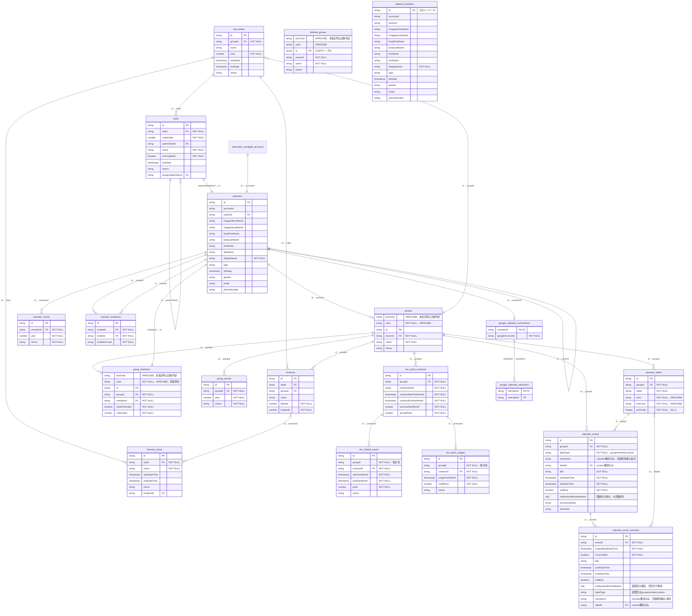

# ER図

## 図の補足

- 図は共通の業務モデルを示す。SQLiteの物理定義・制約・インデックスは[`offline_schema.drift`](../lib/infrastructure/database/offline_schema.drift)を参照。
- `deleted_groups`・`deleted_members`はFirestoreの専用コレクションとSQLiteの専用テーブルに対応する。親の退避時は、元のドキュメントID・行IDをそのまま主キーにし、親の全フィールドを保存する。Firestoreでは取得データをそのまま保存し、`createdAt`・`updatedAt`やオンラインの`version`を含むフィールドを欠落させない。通常テーブルの親は残さず、退避保存と元データ削除を原子的に行う。
- 図の通常グループ・メンバーへの関連線は元のIDによる論理的な関係を示す。退避後は同じIDの親が削除済み保存先にあり、関連データ・所属・タスク担当のIDは変更しない。通常の取得で退避先を参照して親を表示せず、削除済み一覧や復活機能は提供しない。
- SQLiteでは通常の`groups`・`members`を参照する外部キーを設けず、`owner_id`・`group_id`・`member_id`・`assigned_member_id`を値として保持する。親削除による連鎖削除・担当解除・所有者参照による削除拒否をなくす。旅行内のタスク・旅程、タスクの親子、予定・個別回・ラベル、DVC契約と利用データの外部キーは維持する。退避テーブルから通常テーブルへの外部キーも設けない。
- 繰り返し予定は`calendar_events`の`recurrenceRule`（RRULE形式）で表し、各回は保存しない。`calendar_event_overrides`は個別回の変更・取消しを表し、`eventId`と`originalStartDateTime`で対象の回を識別する。取消しの場合、変更内容の各フィールドは空になる。
- Firestoreでは個別回の変更・取消しを独立した`calendar_event_overrides`コレクションへ保存する。`eventId`・`groupId`・`originalStartDateTime`・`isCancelled`と変更内容を持ち、ドキュメントIDは親予定IDと正規化した元の開始日時（マイクロ秒）の組で一意にする。終日の元日時・変更後の期間はUTCの年月日として保存する。
- Firestoreの親予定は`overrideIds`（個別回のドキュメントID一覧）と`referencedLabelIds`（親と個別回が参照する色ラベルID一覧）を持つ。系列の分割・変更・削除は、親予定・対象の個別回・色ラベルの参照数を同じトランザクションで保存し、競合照合では個別回もトランザクション内で読み取る。グループの退避では親予定・個別回・色ラベルを削除せず保持する。一覧取得ではグループの親予定を通常のクエリで取得し、対応する個別回を通常のドキュメント取得で読み込む。読み込みにトランザクションは使用しない。

- DVCポイント利用・期間限定ポイントはそれぞれ1つの契約に属し、`contractId`をFirestore・SQLite・バックアップで保持する。`groupId`は親契約と同じ値を保存し、グループの一覧・年表集計に使う。利用履歴または期間限定ポイントがある契約は削除できない。SQLiteでは子から契約への参照を`ON DELETE RESTRICT`とし、DVCの`group_id`は通常グループ削除による連鎖削除を持たせず、退避後もIDと関連データを保持する。

- `calendar_labels`は任意ラベルのみを保存する。固定ラベルは`groups.color`と所属順の`group_members.color`から組み立てる。文字色はそれぞれの`textColor`を使用し、未指定時は背景色から読みやすい白・黒を選ぶ。グループ固定は予定の`groupId`、メンバー固定は`memberId`で参照する。種別に対応しない参照はNULLとする。所属解除・メンバー削除後も固定参照は保持し、再加入時は現在の所属色を使う。`referencedLabelIds`と任意ラベルの使用件数は任意ラベルの参照だけを集計する。
