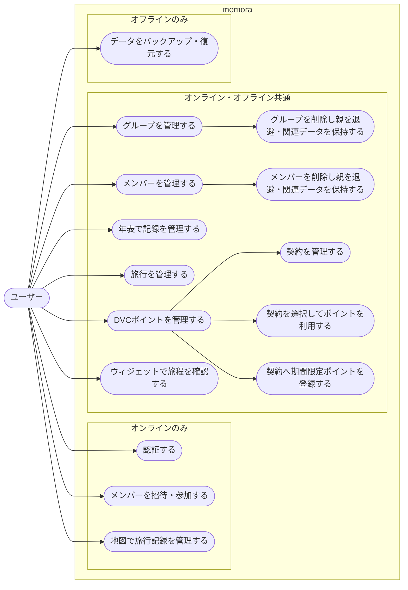

# ユースケース図

主要な利用目的と利用できるアプリモードを示す。詳細な仕様と受け入れ条件は[ユーザーストーリー](user_stories.md)を参照。

グループ・メンバーの削除は、親の全情報を元のIDで専用の削除済み保存先へ移し、通常の保存先から除く。退避と元データ削除は原子的に行い、関連データ・所属・担当は保持する。退避した親は通常画面とAndroidウィジェットで表示・選択・操作できず、削除済み一覧や復活操作は提供しない。
