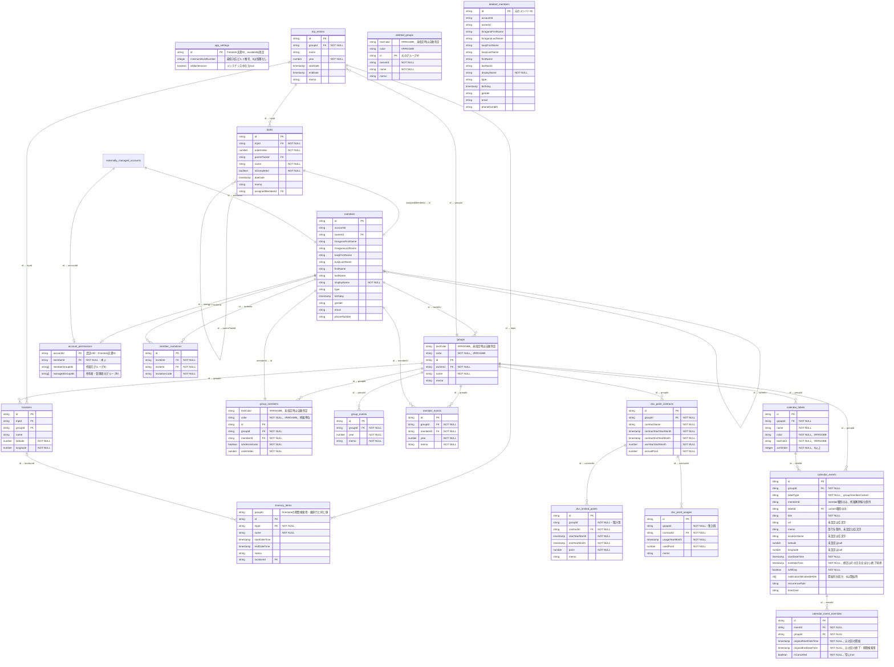

# ER図

`account_permissions`と`member_events.groupId`は実装予定の構造を示す。対応範囲と移行作業は[todo](todo.md)を参照。

## 図の補足

- 図は共通の業務モデルを示す。SQLiteの物理定義・制約・インデックスは[`offline_schema.drift`](../lib/infrastructure/database/offline_schema.drift)を参照。
- `app_settings/availability`はオンライン専用の利用停止設定。文書が未作成なら`minimumBuildNumber: 0`・`isMaintenance: false`として扱う。SQLiteやオフラインバックアップには含めない。
- `account_permissions`はオンライン専用の認可コレクションで、認証UIDごとに1文書を持つ。`memberGroupIds`と`managedGroupIds`はグループIDの重複を持たない一覧で、管理対象は所属先の一部とする。所有者のグループも管理対象に含める。SQLiteやオフラインバックアップには含めない。
- `member_events`はグループとメンバーの両方に属し、`groupId`・`memberId`・`year`の組ごとに1件のメモを持つ。同じメンバー・同じ年でもグループごとに別の記録を保持する。
- `deleted_groups`・`deleted_members`はFirestoreの専用コレクションとSQLiteの専用テーブルに対応する。親の退避時は、元のドキュメントID・行IDをそのまま主キーにし、親の全フィールドを保存する。Firestoreでは取得データをそのまま保存し、`createdAt`・`updatedAt`やオンラインの`version`を含むフィールドを欠落させない。通常テーブルの親は残さず、退避保存と元データ削除を原子的に行う。
- 図の通常グループ・メンバーへの関連線は元のIDによる論理的な関係を示す。退避後は同じIDの親が削除済み保存先にあり、関連データ・所属・タスク担当のIDは変更しない。通常の取得で退避先を参照して親を表示せず、削除済み一覧や復活機能は提供しない。
- SQLiteでは通常の`groups`・`members`を参照する外部キーを設けず、`owner_id`・`group_id`・`member_id`・`assigned_member_id`を値として保持する。親削除による連鎖削除・担当解除・所有者参照による削除拒否をなくす。旅行内のタスク・旅程、タスクの親子、予定・個別回・ラベル、DVC契約と利用データの外部キーは維持する。退避テーブルから通常テーブルへの外部キーも設けない。
- 繰り返し予定は`calendar_events.recurrenceRule`（RRULE形式）から展開する。「この回だけ変更」は元の回を取り消し、変更内容を独立した通常予定として保存する。通常予定は元の系列・回への紐付けを持たず、元系列の変更・削除から独立する。復元・リセット操作は提供しない。
- `calendar_event_overrides`は取消情報だけを持つ。系列IDと正規化した元の開始日時で回を識別し、元の終了日時も保持して複数日にまたがる取消を期間取得する。Firestoreの文書IDは系列IDと元の開始日時（マイクロ秒）の組で一意にする。終日の日時はUTCの年月日として保存する。
- Firestoreの親予定は取消の`overrideIds`と、その予定の任意ラベルを示す`referencedLabelIds`を持つ。系列の変更・分割・削除、取消の更新、独立した通常予定の作成とラベル使用件数の更新を同じトランザクションで保存し、既存の集約単位の競合検出を維持する。
- 通常予定は表示期間と重なる予定、繰り返し系列は検索用の終了境界`recurrenceEndDateTime`が取得期間に達する系列を取得する。取消は対象の系列・グループと元の回の期間で絞り、画面・通知・ウィジェットの通常取得では親の取消IDを全件たどらない。系列の保存では取得していない取消を維持し、編集開始時の期待バージョンを使う。読み込みにトランザクションは使用しない。

- DVCポイント利用・期間限定ポイントはそれぞれ1つの契約に属し、`contractId`をFirestore・SQLite・バックアップで保持する。`groupId`は親契約と同じ値を保存し、グループの一覧・年表集計に使う。利用履歴または期間限定ポイントがある契約は削除できない。SQLiteでは子から契約への参照を`ON DELETE RESTRICT`とし、DVCの`group_id`は通常グループ削除による連鎖削除を持たせず、退避後もIDと関連データを保持する。

- `calendar_labels`は任意ラベルのみを保存する。固定ラベルは`groups.color`と所属順の`group_members.color`から組み立てる。文字色はそれぞれの`textColor`を使用し、未指定時は背景色から読みやすい白・黒を選ぶ。グループ固定は予定の`groupId`、メンバー固定は`memberId`で参照する。種別に対応しない参照はNULLとする。所属解除・メンバー削除後も固定参照は保持し、再加入時は現在の所属色を使う。`referencedLabelIds`と任意ラベルの使用件数は、系列と独立した通常予定それぞれの任意ラベル参照を集計する。

- 旅程ウィジェットは所属グループと旅程の開始日時で表示日と前後の日付を取得し、旅行の登録年・旅行期間に依存しない。Firestoreの旅程は検索用の`groupId`を親旅行と同じ保存単位で更新する。SQLiteは親旅行と結合してグループを絞る。ウィジェット用の取得では場所の詳細を取得しない。

- オンラインの`members`には認可参照用の`groupIds`と`managedGroupIds`を保持する。所属・役割と認可文書と同じ原子的な更新に含め、通常のプロフィール編集では変更しない。SQLite・オフラインバックアップには含めない。プロフィールと所属更新は同じ文書のバージョンで競合し、プロフィールの閲覧者に全所属グループIDが見えることを許容する。
